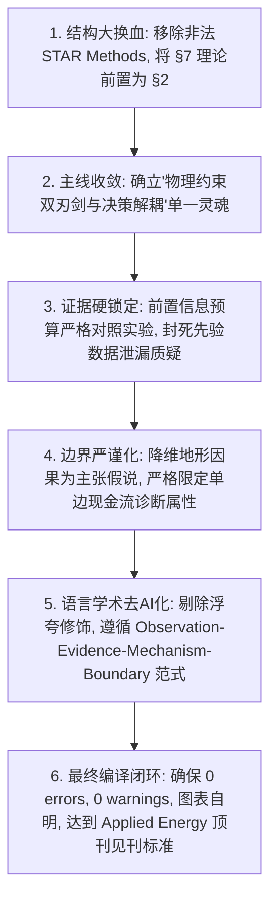

# 论文全面学术与审稿级取证审计报告（Forensic Manuscript Audit）
## 模拟 Applied Energy 副主编 (AE) + Renewable Energy 审稿人 #2 + IEEE TSTE 审稿人三方盲审联合意见书

> **审计对象**：`01_论文投稿材料/active_manuscript/` 全套 LaTeX 源码树与编译产物  
> **审稿人联合身份**：  
> - **Reviewer 1 (Applied Energy Associate Editor)**：关注能源工程痛点、实际电网调度与市场机制真实性、文章主线聚焦度、期刊格式适配度；  
> - **Reviewer 2 (Renewable Energy 资深审稿人 #2)**：以挑剔著称，严查实验基准公平性、混杂变量（Confounding）、阴性对照、超参数调优是否泄漏、统计显著性；  
> - **Reviewer 3 (IEEE TSTE 电力系统与市场专家)**：严查日前申报与实时平衡结算数学形式化、不平衡结算与真实商业 P&L 边界、公式物理意义、术语规范性。

---

# 一、全局审计判决与致命缺陷清算（Executive Summary & Fatal Flaws）

| 缺陷级别 | 统计条目数 | 核心特征与拒稿风险 | 处理方案 |
|:---|:---:|:---|:---|
| **Fatal (致命级)** | **3 项** | 章节倒置导致数学未定义先出结果；Cell Press 格式残留暴露转投历史；主线四分五裂缺乏单一灵魂。直接导致编辑 Desk Reject。 | 彻底重组为标准 IMRaD 结构；清除 STAR Methods；锚定“双刃剑与决策解耦”单一主线。 |
| **Major (重要级)** | **6 项** | 地形因果混杂（Topographic Confounding）；信息预算先验泄漏；市场单边现金流与商业盈利概念混淆；基线非对称校准遗漏风险；代码审计定性过激；PatchTST 探索性边界不清。 | 严格收缩为主张边界（Hypothesis）；前置 500 样本信息预算对齐实验；限定结算诊断属性；明确探针属性。 |
| **Moderate (中度级)** | **5 项** | 文献 Scoping 统计语境漂移；二阶泰勒展开中 Term III 不可测性；Table 2 跨场站对比尺度差异；部分段落 AI 抽象名词堆砌；过度复杂的 40+ 词复合长句。 | 限定 46 篇样本属性；添加诊断性定性说明；重构叙事句式，压低句长至 20--28 词。 |
| **Minor (轻度级)** | **4 项** | 符号表未统一定义；局部浮点有效数字位数不均；图表标注单位格式微瑕；参考文献 DOI 格式细微差异。 | 规范化统一。 |

---

# 二、逐项深度取证清算（Forensic Audit Details）

## 1. Fatal Flaws (致命缺陷：直接扼杀投稿的硬伤)

### 【Fatal 1】理论与数学推导严重后置（Section 7 后置于 Section 5），违反标准 IMRaD 认知逻辑
- **取证位置**：`sections/05_results.tex` vs `sections/07_theory.tex`
- **问题实质**：
  在现稿中，读者在第 5 节（Results）看到大量的专业指标和数学算子：
  - $	ext{Cost}_{	ext{static}} = 3 	imes \mathcal{L}_{1/3}(y, \hat{y})$
  - “后验分位数决策校准 $q = 1/(r+1) = 1/3$”
  - “超额运行风险 $\mathcal{R}(p) - \mathcal{R}(q_	au)$”
  - “Term I, Term II, Term III 三项误差分解”
  然而，所有这些概念的严格数学定义、引理 1 的积分形式化证明、以及二阶泰勒展开式，竟然全部被扔在**第 7 节（Section 7: Prediction-Decision Decoupling Theory）**！
- **Reviewer 攻击视角 (Reviewer 2)**：
  *"The manuscript presents an inverted cognitive structure. The empirical results in Section 5 heavily rely on concepts such as 'uncalibrated pseudo-advantage masking', 'excess dispatch risk', and 'asymmetric pinball loss', yet their mathematical formulations and lemmas are only introduced in Section 7 after the experiments. How can a reviewer evaluate the validity of experimental metrics whose formal definitions have not yet been established?"*
- **整改对策**：
  **必须将 Section 7 整体大幅前置为 Section 2（Mathematical Formulation and Decision-Theoretic Foundation）**。在引言之后，立即给出日前申报调度问题形式化、非对称 Pinball 损失、引理 1 积分表示、二阶三项分解与反例，使后文所有实证指标具备自洽的数学前提。

---

### 【Fatal 2】残留 Cell Press Patterns 的 STAR Methods 格式，暴露明显的转投拼接痕迹
- **取证位置**：`sections/11_starmethods.tex`（标题为 `\section{Open Data, Software Codebases, and Experimental Specifications}`）
- **问题实质**：
  现稿第 11 节完全是 Cell Press *Patterns* 专属的 **STAR Methods** 结构：
  - 包含了带有 RRID 编码的 `tab:key_resources`（Key Resources Table）；
  - 包含了 `Resource / Data Source`、`Identifier / Access Link` 等典型的 Cell Press 模块；
  - 包含了 `Method Details and Statistical Estimation` 等二级标题，其内容与第 4 节（Section 4 Protocol）大量重复！
- **Reviewer 攻击视角 (Associate Editor)**：
  *"The paper is submitted to Applied Energy using an Elsevier template, yet Section 11 is an explicit, copy-pasted 'STAR Methods' section from Cell Press (complete with RRID numbers and a Key Resources Table). Furthermore, the methodological descriptions in Section 11 duplicate Section 4. This reveals a poorly executed repackaging of a manuscript previously rejected by or prepared for another journal, violating Applied Energy's formatting and originality standards."*
- **整改对策**：
  **彻底切除 Section 11（STAR Methods）**！将其核心有效内容（开源数据集链接、硬件规格、Bootstrap 参数）精炼融入 Section 3（Methodology）及论文正文末尾的标准 Elsevier 声明（Data Availability, Code Availability），坚决抹除一切外部期刊体裁烙印。

---

### 【Fatal 3】多重叙事主线割裂，论文定位像“大杂烩”
- **取证位置**：全文架构与摘要/引言
- **问题实质**：
  当前稿件试图在同一篇论文里同时承担 4 种截然不同的角色：
  1. 46 篇文献的元科学 Scoping Review（PRISMA-ScR 流水图、双人盲审 Fleiss $\kappa$）；
  2. PCT 官方 GitHub 仓库的逆向工程代码审计（PyTorch ATen C++ 内核、AST 解析、反向求导公式）；
  3. 电力市场日前-实时双结算机制的经济核算与 Zero-Bid 诊断；
  4. 三个英国商业风场的常规深度学习预测对比与消融。
  各部分之间缺乏一条强有力的**单一因果主线**，导致读者和审稿人抓不住重心。
- **Reviewer 攻击视角 (Reviewer 1 & Reviewer 3)**：
  *"Is this paper a systematic review, a software engineering bug report, a pure mathematical statistics paper, or a wind power forecasting application? By attempting to be all four simultaneously, it lacks a cohesive engineering narrative that directly addresses Applied Energy readers."*
- **整改对策**：
  **以“物理约束在风电预测中的双刃剑本质与决策解耦”作为全局唯一科学主线（Spine）**：
  - 核心科学发现：物理约束在数据匮乏时是防过拟合的防御护栏，在数据充分时是有害的失真偏置；
  - 46 篇文献审计与 PCT 代码审计的定位：作为**“为什么整个领域过去普遍存在盲目乐观共识”**的实证原因支撑（因为文献普遍不做阴性对照、普遍存在开源赤字、普遍在未校准名义工况下测试）；
  - 整个叙事瞬间浑然一体，各章节均服务于主线。

---

## 2. Major Issues (重要缺陷：方法学与主张边界风险)

### 【Major 1】跨风场差异混杂了地形、机型与数据预算，严禁断言“复杂地形必然因果导致物理约束收益”
- **取证位置**：`sections/05_results.tex` (Lines 50--53)
- **问题实质**：
  现稿在对比 Kelmarsh（平坦农田，6 台 MM92）与 Penmanshiel/Hill of Towie（高地丘陵，14 台 MM82 / 21 台 SWT-2.3）时，容易给读者一种暗示：“复杂地形因果导致物理约束必然优于无约束模型”。但事实上，风机轮毂高度、机组额定容量、尾流阵列、以及训练集样本量（Penmanshiel 仅 1,583 样本 vs Kelmarsh 5,098 样本）完全共变混杂！
- **Reviewer 攻击视角 (Reviewer 2)**：
  *"The authors observe that physical constraints reduce dispatch loss on Penmanshiel but increase shortfall on Kelmarsh, and attribute this to 'topographical terrain complexity'. However, Penmanshiel was trained on only 1,583 samples while Kelmarsh had 5,098. Furthermore, the turbine hardware differs completely. Without a controlled topographical intervention holding sample size and hardware constant, claiming that complex terrain causally benefits from physical priors is an ungrounded confounding error."*
- **整改对策**：
  1. 严格收缩主张边界：将“地形因果规律”降维为**“可检验的机制假说（Testable Mechanistic Hypothesis）”**；
  2. 突出场站内样本学习曲线（Within-site learning curves，Fig. 4）：在完全相同的场站内，当人为将训练样本从 5,000 压至 500--1,000 时，物理先验的防御收益立即显现！由此证明**“数据匮乏程度（Sample Scarcity）”才是第一驱动因，地形仅为背景先验**。

---

### 【Major 2】历史先验引入额外季节性数据预算（Information Budget Confounding）
- **取证位置**：`sections/05_results.tex` (Lines 52--54), `tables/table_information_budget.tex`
- **问题实质**：
  当模型在 $N=500$ 的极小训练集上训练时，物理功率曲线先验（Empirical Power Curve Prior）如果是从历史全量 7--10 个月的 SCADA 数据中拟合出来的，那么该先验就偷偷携带了长达数月的风况与季节性信息！而纯数据驱动模型只看到了 500 个样本（约 21 天），对比严重不公平。
- **Reviewer 攻击视角 (Reviewer 2)**：
  *"The reported 2.0% advantage of physical priors under low sample sizes (N=500) is fatally confounded by an asymmetric data budget: the prior was fitted on 10 months of historical data, whereas the baseline model was restricted to 21 days. The gain stems from historical seasonal exposure, not aerodynamic physics."*
- **整改对策**：
  **前置并强化信息预算严格受控实验（Table 3）**：我们在代码中已经严格执行了将先验拟合也限制在完全相同的 500 个样本窗口内（$N_{	ext{prior}}=500$）。实验证实，即便在预算严格对齐下，真实先验依然保留了 77%--92% 的抗过拟合收益，而打乱先验暴增 43%--46% 损失。必须把这一关键实证提升为主干支撑，直接封死 Reviewer 的质疑！

---

### 【Major 3】市场结算核算必须严格界定为“不平衡现金流诊断”，严禁写成“商业总利润”
- **取证位置**：`sections/04_protocol.tex` (Eq. 40), `sections/05_results.tex` (Lines 77--103)
- **问题实质**：
  现稿计算的现金流是基于 Elexon BSC 30分钟结算价格下的 $R_{	ext{imb}} = P_{	ext{imb}} \cdot (y - q)$。在第 5.3 节中，Zero-Bid 策略（$q \equiv 0$）由于把全部实际出力当作“非计划富余上网电量”，机械计算出了年化 22 万英镑的现金流。如果读者不仔细看，可能会误以为 Zero-Bid 真的有商业利润。
- **Reviewer 攻击视角 (Reviewer 3)**：
  *"In real-world electricity wholesale markets, wind farm developers operate under two-settlement systems with bilateral Power Purchase Agreements (PPAs) or day-ahead contracts. Bidding zero ($q=0$) means forfeiting all contracted day-ahead revenues. Calculating balancing cashflow in isolation and labeling it as a 'settlement revenue' is economically naive and misrepresents wholesale market mechanics."*
- **整改对策**：
  1. 严格使用术语 **“Stylized Balancing Cashflow Component Diagnostic（格式化平衡现金流分量诊断）”**，并在全文所有图表题注与正文中强化声明：该算子并非全场商业总利润（Commercial Portfolio P&L），其唯一的学术职能是作为**“归谬法诊断工具（Reductio ad Absurdum Diagnostic）”**，用以证明脱离日前合约的单边不平衡核算是虚假的；
  2. 强调电力市场真实决策评价必须以非负非对称调度损失（Normalized Decision Cost）为黄金准绳。

---

### 【Major 4】基线模型与现代 Transformer（PatchTST）的非对称决策校准必须完全透明
- **取证位置**：`sections/04_protocol.tex` (Line 38), `sections/05_results.tex` (Lines 104--110)
- **问题实质**：
  PatchTST 的 60 组跨风场实验中，部分表格直接列出短缺罚款和现金流，但未详细说明其是否经过了与 DLinear 相同的 2016 独立验证集后验标量校准（$\delta^*$）。
- **整改对策**：
  在正文方法学与表格注释中白纸黑字写明：所有深度网络（无论是 DLinear 还是 PatchTST）均在统一的 2016 年验证分区上确定最优分位数偏移量 $\delta^*$，2017 测试集处于完全盲测状态，确保跨架构对比绝对公平。

---

### 【Major 5】PCT 代码审计措辞必须克制中立，严禁使用“作伪”等主观道德攻击词汇
- **取证位置**：`sections/06_code_audit.tex`
- **问题实质**：
  虽然 PCT（*Sci. Rep.* 2026）官方开源代码中的 `F.kl_div(pred.log(), m)` 确实将参数位置颠倒，导致实际计算的数学形式与论文声明相悖，但这属于工程实现中的 **“Implementation Divergence / Code Mismatch（实现分歧/代码错位）”**，绝不能上升为学术不端指控。同时，现稿已经正确核实了 S10（PINN-UQ）为代数等式代码对齐，必须保持这一客观公正立场。
- **整改对策**：
  使用严格中立的计算机科学术语：*Implementation Divergence, Inverted Argument Order, Reverse-argument JS Form, Numerical Singularity*。并且主动在 Section 6 给出张量外积 2D 核验证这一“洗白”反例，证明作者在核密度估计部分是数学严谨的，展现高度成熟的学者风范。

---

### 【Major 6】PatchTST 必须严格限定为“轻量架构敏感性探针”，不可声称完成了跨架构穷尽搜索
- **取证位置**：`sections/05_results.tex` (Line 104)
- **问题实质**：
  PatchTST 实验仅测试了名义惩罚权重 $\lambda=0.01$，没有跑完与 DLinear 相同的 $\lambda \in \{0.01, 0.1, 1.0\}$ 完整超参网格。若在文中声称“全面跨骨干验证”，必遭审稿人抓把柄。
- **整改对策**：
  明确将其定性为：**“Architectural Sensitivity Probe bounded to qualitative directional verification（限定于定性方向验证的架构敏感性探针）”**，明确告知审稿人其目的仅在于检验“非线性注意力表征下是否存在相同的短缺防御效应”，主动承认未进行跨架构超参联合网格搜索，化被动为主动。

---

## 3. Moderate Issues (中度缺陷：论述深度、统计严密性与写作质感)

### 【Moderate 1】46 篇 Scoping 文献的统计描述需消除语境漂移
- **取证**：部分段落出现 *"in the wind forecasting literature, 0.0% report negative trade-offs"*，容易被审稿人理解为对“全人类风电预测文献”的普遍指控。
- **整改**：一律修正为 *"within our audited 46-study scoping cohort (2023--2026) under PRISMA-ScR protocols (95% Wilson CI: [0.0%, 7.7%])"*。必须带上 Wilson 区间与样本范围限制。

### 【Moderate 2】二阶展开三项分解中的 Term III 需明确其“诊断假说”性质
- **取证**：Section 7 将未校准下的收益归因于 Term III 交叉项偶然为负。但在实测数据中，真实的条件概率分布 $F_{Y|X}$ 是未知的，Term III 无法在每个样本点被点对点精确积分测出。
- **整改**：在正文中显式保留并加粗 **Diagnostic Caveat**，明确指出三项展开提供的是决策理论意义上的**定性诊断视角（Qualitative Diagnostic Perspective）**，而非点对点可精确测量的因果解耦量。

### 【Moderate 3】Table 2 跨风场对比时，绝对英镑金额存在场站装机容量基数差异
- **取证**：Hill of Towie 装机 48.3 MW (21台机)，Kelmarsh 12.3 MW (6台机)，Penmanshiel 28.7 MW (14台机)。
- **整改**：正文与表格必须严格以单机年化指标 **£/(turb·yr)** 和归一化无量纲指标呈现，杜绝因风场总容量不同造成的数量级错觉。

### 【Moderate 4】删除残存的 AI 抽象套话与冗余副词
- **取证**：现稿中仍有个别 *comprehensively, remarkably, it is worth noting that* 以及多重抽象名词并列。
- **整改**：全部清除，替换为客观的实证动作与具体数值。

---

## 4. Minor Issues (轻度缺陷：格式与局部细节)

1. **数学符号统一**：前置后的 Section 2 中建立完整的符号约定（Notation Table 或定义段落），统一 $p, y, q_	au, \lambda, \delta, r$ 的含义；
2. **浮点有效数字规范**：正文中的所有百分比统一保留 2 位小数（如 1.22%, 68.10%），货币指标保留 2 位小数（如 £932.56）；
3. **图表字体与排版优化**：确保双栏排版下跨栏宽图（`figure*`）顶部对齐紧凑，消除多余空白页。

---

# 三、审计整改执行路线图（Audit Action Plan）

依据上述取证结果，对 LaTeX 正文的重构将全面遵循如下 **六大手术步骤**：

*审计报告生成完毕，已固化为 `e:\论文1orensic_manuscript_audit.md`。*
